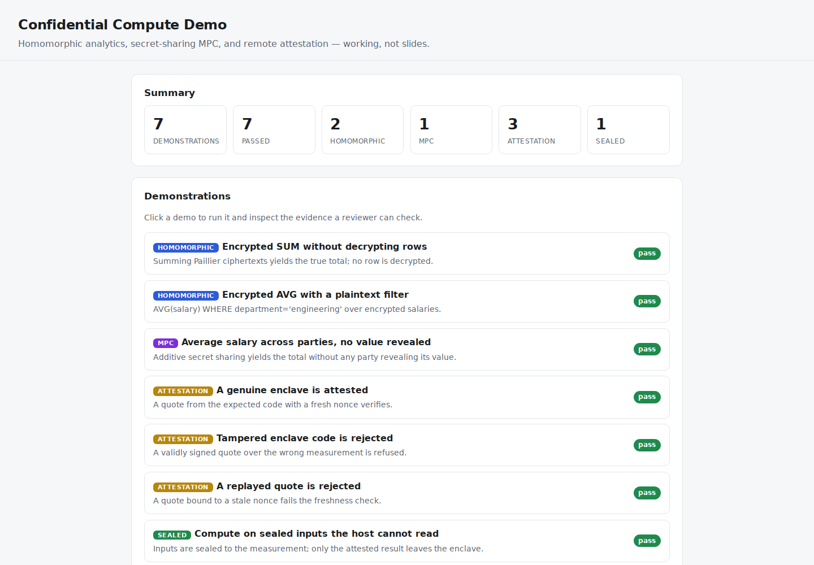
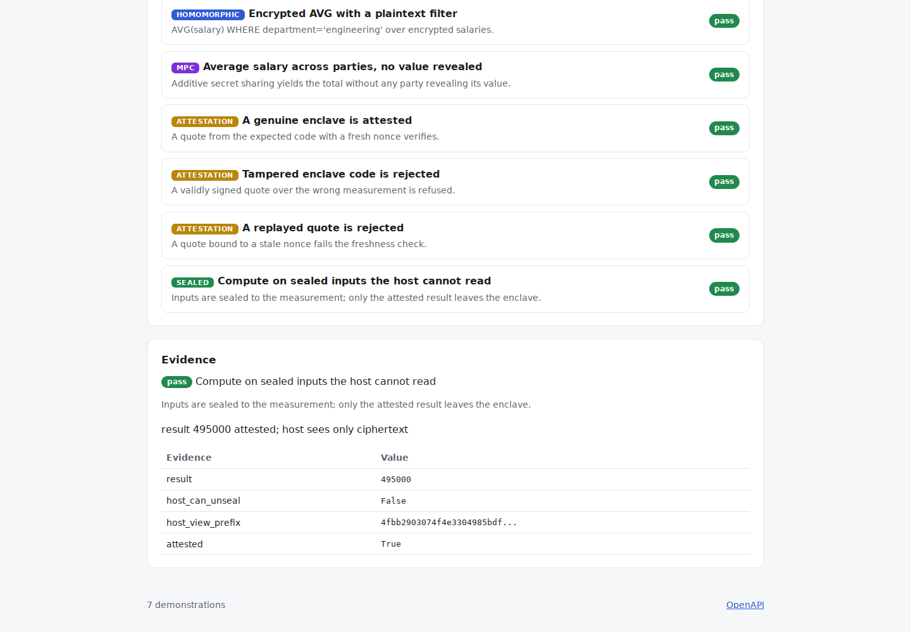

# Confidential Compute Demo

**Compute on data you can't see. This project implements the building blocks of
confidential computing for real — Paillier homomorphic analytics, secret-sharing
MPC, and Ed25519 remote attestation — and proves each one against a plaintext
reference, deterministically.**

[](https://github.com/Vincent-P-essy/confidential-compute-demo/actions/workflows/ci.yml)
[](pyproject.toml)
[](LICENSE)

Regulation (DORA, data-residency, banking confidentiality) is pushing sensitive
workloads toward confidential computing, but most write-ups stop at slides. This
one ships working primitives:

- **Paillier homomorphic encryption** — a from-scratch additively-homomorphic
  cryptosystem, used to run `SUM`, `COUNT`, and `AVG` over an **encrypted** salary
  column with a plaintext filter. No row is ever decrypted.
- **Additive secret-sharing MPC** — several parties compute the average salary
  without any party revealing its own number.
- **Remote attestation** — an enclave measures its code and signs an Ed25519
  quote; a verifier accepts only the expected measurement with a fresh nonce, and
  rejects tampered code and replays.
- **Sealed computation** — inputs are AES-GCM-sealed to the enclave measurement,
  computed on internally, and only the attested result leaves; the host sees
  ciphertext.

Every demo is deterministic and checked against a plaintext reference, so the
catalogue doubles as a correctness suite. It is a portfolio-grade prototype with
demonstration keys — **never** for real data — and it says so loudly.

## Dashboard Preview





Local cryptographic demonstrations and simulated attestation checks provided by the repository. The preview does not establish hardware enclave deployment.

## Measured evidence

| Measurement | Reviewed result | Scope |
|---|---:|---|
| Demonstrations passing | **7/7** | Each vs a plaintext reference or expected rejection |
| Homomorphic SUM correctness | **exact** | Decrypted total equals plaintext total |
| MPC secure total correctness | **exact** | Equals true total; no share leaks a value |
| Attestation controls | **3/3** | Accept genuine; reject tampered code and replays |
| Determinism across 100 passes | **1 identical outcome hash** | Ciphertexts, signatures, sealed blobs all stable |
| Test coverage | **96.23%** | Branch-aware source coverage |

See the [methodology](docs/METHODOLOGY.md) and [reviewed reference run](benchmarks/reference/README.md).

## The seven demonstrations

| Demo | Primitive | What it proves |
|---|---|---|
| `homomorphic-encrypted-sum` | Paillier | Summing ciphertexts gives the true total; no row decrypted |
| `homomorphic-filtered-average` | Paillier | `AVG(salary) WHERE department='engineering'` over encrypted salaries |
| `mpc-secure-average` | secret sharing | Average across parties with no value revealed |
| `attestation-accept` | Ed25519 | A genuine quote with a fresh nonce verifies |
| `attestation-reject-tampered` | Ed25519 | A validly signed quote over the wrong measurement is refused |
| `attestation-reject-replay` | Ed25519 | A quote bound to a stale nonce fails the freshness check |
| `sealed-computation` | AES-GCM + attestation | Compute on sealed inputs the host cannot read; attest the result |

## How the homomorphic query works

Paillier gives `E(a) · E(b) = E(a + b)`. To answer `SELECT SUM(salary) WHERE
department = 'engineering'`, the engine multiplies the ciphertexts of the matching
rows and decrypts **only** the product — the individual salaries never leave
ciphertext form:

```
495000  = decrypt( E(95000) · E(120000) · E(110000) )   # engineering rows
```

That is additive homomorphism doing real encrypted analytics. Arbitrary SQL on
ciphertext would need fully-homomorphic encryption; that boundary is stated in
the [limitations](docs/LIMITATIONS.md).

## Quick start

Requirements: Python 3.11 or 3.12 and [`uv`](https://docs.astral.sh/uv/).

```bash
uv sync --frozen --all-extras

# Run every demonstration with its evidence
uv run ccdemo demo all

# Inspect the sealed-computation demo
uv run ccdemo demo sealed-computation

# Measure it (deterministic)
uv run ccdemo benchmark --iterations 100
```

Start the API and dashboard:

```bash
uv run ccdemo serve --host 127.0.0.1 --port 8080
```

Open <http://127.0.0.1:8080> to run each demo and inspect its evidence. OpenAPI is
at `/docs`.

## Important limitations

- **Demonstration keys, not secure cryptography.** Paillier keys are seeded and
  small for reproducibility and speed; sealing nonces are fixed. Never protect
  real data with this.
- **Additive homomorphism only** (`SUM`/`COUNT`/`AVG`); arbitrary computation on
  ciphertext needs fully-homomorphic encryption.
- **Attestation is a software simulation** — the Ed25519 signing/verification is
  real, but there is no SGX/TDX hardware root of trust.
- **MPC assumes honest-but-curious parties** over a trusted transport.
- The local API is unauthenticated and must be bound to loopback.

See [architecture](docs/ARCHITECTURE.md), [methodology](docs/METHODOLOGY.md),
[limitations](docs/LIMITATIONS.md), and [`SECURITY.md`](SECURITY.md).
