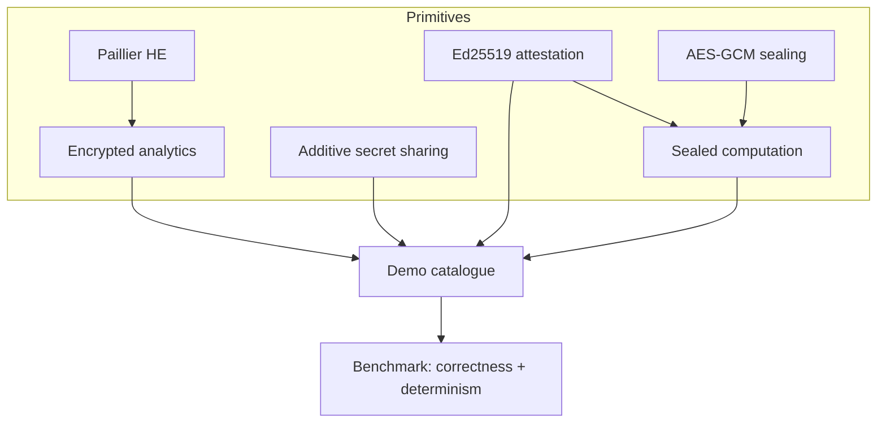

# Architecture

Four confidential-computing primitives, each implemented for real, wired into a
catalogue of seven end-to-end demonstrations.

## Paillier homomorphic encryption (`paillier.py`)

Textbook Paillier with the `g = n + 1` optimization. `E(a) * E(b) = E(a + b)` and
`E(a)^k = E(k*a)`, so ciphertexts can be summed and scaled without the key.
`encrypted_analytics.py` uses this for `COUNT`, `SUM`, and `AVG` over an encrypted
column, with an optional filter on a plaintext attribute — only the aggregate is
ever decrypted.

## Additive secret sharing (`mpc.py`)

Each party splits its value into one uniform random share per party over a prime
field; every party sums the shares it receives; the partial sums combine to the
total. Any single share is independent of the secret, so no individual value is
revealed — the classic secure-sum protocol behind privacy-preserving analytics.

## Remote attestation (`attestation.py`)

An enclave measures its code (SHA-256, standing in for MRENCLAVE) and signs a
quote over `(measurement, nonce, report_data)` with an Ed25519 platform key. The
verifier accepts only if the signature is valid under a trusted key, the
measurement matches, and the nonce is fresh. The signing and verification are
real; the hardware root of trust is simulated.

## Sealed computation (`enclave.py`)

Inputs are sealed with AES-256-GCM under a key derived from the measurement, so
only an enclave running the expected code can unseal them. The enclave unseals
internally, computes, and returns the result plus an attestation quote binding
it. The host observes ciphertext, a result, and a verifiable quote — never a
plaintext input.

## Determinism by design

Keys, secret shares, and sealing nonces are all derived from fixed seeds, and
Ed25519 signatures are deterministic (RFC 8032). So every demo — down to the
ciphertext bytes — reproduces exactly, which is why the catalogue can serve as a
correctness suite with a single stable benchmark hash. That reproducibility is
also why these keys must never protect real data; see the [limitations](LIMITATIONS.md).
